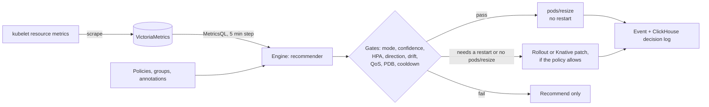

# K8s Tailor

**A self-hosted Kubernetes pod rightsizer built around in-place resize: it learns what your containers really use and resizes running pods without restarting them.**

[](https://github.com/nicacioliveira/k8s-tailor/actions/workflows/ci.yml)
[](LICENSE)
[](docs/INSTALL.md#1-prerequisites)
[](https://nicacioliveira.github.io/k8s-tailor/docs/)
[](#project-status)


<sub>Every screenshot in this repository uses synthetic fixture data, not a real fleet. See [docs/SCREENS.md](docs/SCREENS.md).</sub>

> **Status.** Pre-1.0 (`v1alpha1` CRDs). It ships **inert**: nothing is changed until you create a policy that turns actuation on. What the repository's suites cover is listed in [How it is verified](#how-it-is-verified); what the engine deliberately does not do is in [docs/KNOWN-ISSUES.md](docs/KNOWN-ISSUES.md).

## Contents

[What and why](#what-and-why) · [Features](#features) · [Screenshots](#screenshots) · [Quickstart](#quickstart-k3d) · [Install on a real cluster](#install-on-a-real-cluster) · [How it works](#how-it-works) ·
[Safety model](#safety-model) · [Configuration](#configuration-overview) · [CLI: backtest](#cli-backtest) · [Advisor](#advisor-optional-llm) · [Observability](#observability) · [Docs index](#documentation-index) ·
[How it is verified](#how-it-is-verified) · [Project status](#project-status) · [Contributing](#contributing) · [Security](#security) · [License](#license)

## What and why

Requests set at deploy time are guesses. They are usually too high (wasted capacity) or, after a traffic change, too low (throttling and OOM kills), and changing them has traditionally meant restarting pods.
Kubernetes can now resize a running pod's CPU and memory in place (the `pods/resize` subresource: beta and on by default in 1.33, stable in 1.35). K8s Tailor measures usage, computes a right-sized request
with plain statistics, and applies it through that subresource, keeping an explainable record of every decision.

What it does that is worth choosing it for:

- **In-place resize as the primary path.** Running pods are resized, not recreated; `make k3s-smoke` checks that the pod UID and `restartCount` are unchanged after a resize. Rollout and Knative-Service patches exist as fallbacks.
- **A learned OOM floor.** When a container with a memory limit is OOMKilled, its limit is protected at `limit x 1.5` for 30 days, so a later shrink cannot push it back to the value that killed it. The floor survives engine restarts: it is stored as an annotation on the Deployment, StatefulSet, DaemonSet or Knative Service, or on the TailorGroup.
- **A decision trail.** Every applied change is stored (ClickHouse, optional), emitted as a Kubernetes Event, and shown with the reasoning (quantile, peak, forecast, headroom breach) and a dry-run `kubectl` patch.
- **Sidecar-aware.** Istio, Linkerd, Vault and similar injected containers are classified, sized from their own usage with a dedicated profile, and stay recommend-only until you opt them in. Init containers are never touched. Classic and native Istio sidecars were exercised against a real Istio 1.31.3 on k3d ([dev/istio/README.md](dev/istio/README.md)).
- **Aware of throttled containers.** Usage pinned at a CPU limit is censored data (the demand is higher); the engine detects it and grows the existing limit in steps instead of settling at the limit forever ([docs/TECHNICAL.md](docs/TECHNICAL.md#censored-cpu)).
- **Safety gates you can read.** Per-resource confidence, direction gate (shrink-only or grow-only), HPA hold, PDB-aware disruption budget, QoS checks, cooldowns, and a global pause switch.

What it deliberately is not: a general FinOps platform, a horizontal autoscaler, a node autoscaler or an ML system. Dollar figures are estimates from static prices unless you wire OpenCost. The "learning" described in [docs/PRODUCT.md](docs/PRODUCT.md) is a roadmap item.

### Related projects and inspirations

K8s Tailor is an independent project: its design, code and customization are its own. It was inspired by ideas from several open-source projects in the Kubernetes resource-management space, and some of them are used as reference points or optional integrations. Facts below were checked against each project's public documentation on 2026-10-21 and will age.

- **Vertical Pod Autoscaler (VPA).** Upstream Kubernetes autoscaling project. Its `InPlaceOrRecreate` update mode resizes in place when possible and otherwise recreates the pod; the Kubernetes 1.35 release blog says it graduated to beta and that an `InPlace`-only mode is still being worked on. The decay-weighted percentile approach in K8s Tailor follows the same family of ideas, and [docs/BACKTEST.md](docs/BACKTEST.md) uses a VPA-style baseline as a methodology reference.
- **KRR** (Robusta). A CLI that computes recommendations from Prometheus-compatible metrics; recommend-only by default, with auto-apply available through a separate component. [docs/BACKTEST.md](docs/BACKTEST.md) uses a KRR-style baseline as a reference.
- **Goldilocks** (Fairwinds). A dashboard that shows VPA recommendations per namespace as a starting point for requests.
- **OpenCost.** An open-source cost-allocation project. K8s Tailor can read node price metrics from it (`PRICING_MODE=opencost`) instead of static prices.
- **Karpenter.** A node provisioner. K8s Tailor does not manage nodes; it only changes pod resources.

What K8s Tailor itself focuses on: in-place actuation through `pods/resize` driven by Kubernetes CRs, a learned OOM floor, Knative revision collapsing, scheduled and direction-gated policies, sidecar handling and an auditable decision trail. It does not depend on VPA and ships its own VictoriaMetrics and ClickHouse (both replaceable). It is pre-1.0. An offline simulation against KRR-style and VPA-style baselines is in [docs/BACKTEST.md](docs/BACKTEST.md) (synthetic scenarios only; read its limitations).

## Features

**Measuring and recommending**
- Decay-weighted percentile (default p90 CPU, p95 memory, half-life 24 h) over a 7-day window, memory floored at the observed peak, per-policy margins, min/max and limit factors.
- Change-point trimming on a median-filtered series, seasonal forecast (daily, weekly, both) gated by a correlation check, HPA-style scale-down stabilization.
- Per-resource confidence (`MIN_SAMPLES`, 288 samples of 300 s = 24 h by default): a resource without enough data is held at its current value. 24 h is deliberate: it covers one full daily cycle, so the engine never shrinks a request after seeing only part of the day (for example only the overnight trough). Lower it only for demos and dev.
- Per-container recommendations, including sidecars and native sidecars. The usage history of pods that have since been replaced (rollouts, evictions) is kept: it is attributed to the owning Deployment or DaemonSet by pod name, so fresh pods are not unconfident for 24 h.
- Memory trend (display only) is published only when it is statistically sound (at least 24 points, R² >= 0.5).

**Applying safely**
- In-place resize via `pods/resize`, including native sidecars; rollout (controller template patch) and Knative Service patch as fallbacks; optional admission webhook that sizes pods at creation (opt-in, `failurePolicy: Ignore`; it patches only `CREATE` of `v1/Pod`, leaves Guaranteed templates alone and records nothing itself, the leader's reconciler logs the decision a few seconds later).
- Direction gate (`Down`, `Up`, `Both`), drift tolerance (15% and 20m CPU / 16Mi memory), up/down cooldowns persisted across restarts, one disruptive resize at a time within the PDB budget. The PDB budget and replica counts are read live from the API server before each disruptive restart, and the failure backoff and the in-progress rolling state are kept in pod annotations, so a restart or failover does not reset them.
- Limits are only raised, never shrunk or invented (a memory limit is created only if you opt in with `memory.enforceLimit`; an existing CPU limit grows only when the container is CPU-censored, never under a shrink-only policy); HPA hold; QoS and pod-level-resource guards; excluded namespaces; global pause.

**Operating it**
- Configuration is Kubernetes CRs (`TailorPolicy`, `TailorProfile`, `TailorGroup`, `TailorConfig`) and annotations; a policy selector turns actuation on for everything it matches, including future workloads, and can be scheduled.
- Groups collapse many workloads (for example Knative revisions) into one unit with pooled usage.
- Built-in sizing presets (`tailor.presets.enabled=true` installs a `bursty` TailorProfile with CPU quantile 0.95 for spiky workloads) and a tunable seasonality gate (`seasonGate`).
- Dashboard with workload reasoning, policy editor, decisions and savings views; per-container mode selects and Exclude switches and per-resource (CPU/memory) confidence on the workloads view; an MCP server exposing the same operations as tools (`POST /api/workload` can write a mode or exclusion for a single container); the dashboard is also served as an MCP App, the open MCP extension (SEP-1865: a `ui://` resource served as `text/html;profile=mcp-app`; SDK [`@modelcontextprotocol/ext-apps`](https://github.com/modelcontextprotocol/ext-apps), MIT), so MCP clients that support it render it inline; Prometheus metrics; a Grafana dashboard.
- Leader election for more than one replica; Helm chart with restricted security contexts, NetworkPolicies, Bearer-gated write API (optionally also reads, `tailor.apiAuth.protectReads`), optional ValidatingAdmissionPolicies.
- Offline backtest CLI (7 synthetic scenarios) and an optional, read-only LLM advisor (English by default, see `tailor.advisor.language`).

## Screenshots

All captured from the synthetic fixture dashboard (1440 px wide). Full tour with captions for each screen: [docs/SCREENS.md](docs/SCREENS.md).

**Workloads, one row per container.** Class badges (`App`, `Native sidecar`, `Sidecar · istio`, `Init`), current to recommended requests, effective mode and where it came from, and how each container would be actuated.
Injected sidecars stay recommend-only until opted in; init containers are never sized.


**Per-container controls.** Each container has its own mode select and an Exclude switch; opting an injected sidecar in to actuation asks for confirmation first.

<p>


</p>

**Why this recommendation.** The audit view for one container: decayed quantile and peak, seasonal forecast, memory trend, headroom breach, actuation method; below it a dry-run patch as copy-ready `kubectl`.

<p>


</p>

**Policies and container rules.** A policy selects workloads and sets mode, method, forecast, headroom and guardrails; per-container rules (first match wins) exclude, cap or opt in sidecars.

<p>


</p>

**Decisions.** Every applied resize with the exact before and after.


**From a real cluster.** The shots above are synthetic fixtures. This one is the Decisions view of the end-to-end run on a k3d cluster with demonstration load (real engine output, tiny synthetic workloads; the AI summary uses a fake LLM). More in [docs/SCREENS.md](docs/SCREENS.md#screens-from-a-real-cluster) and the run in [docs/E2E.md](docs/E2E.md).


## Quickstart (k3d)

Needs `docker`, `k3d`, `kubectl` and `helm` on your PATH. This creates a one-node k3d cluster (`tailor-dev`, `rancher/k3s:v1.34.12-k3s1`), builds both images locally, installs the chart with `dev/k3s/values-dev.yaml` and applies the `demo/` workloads.

```bash
make k3s-up       # cluster + images + chart + demo workloads (first build is slow)
make k3s-smoke    # asserts an in-place resize happened: same pod UID and restartCount, new requests
make k3s-down     # remove the cluster
```

The dev values set `MIN_SAMPLES=2` (about 10 minutes of history, because the engine samples on a fixed 300 s step) so the demo converges quickly; the smoke test takes roughly that long. Open the UI:

```bash
kubectl --context k3d-tailor-dev -n k8s-tailor port-forward svc/k8s-tailor-mcp 8020:8020     # http://localhost:8020
```

The dev values disable the Bearer sidecar (`mcp.auth.enabled=false`, `allowUnauthenticated=true`); never do that outside a local cluster. Details and variables: [dev/k3s/README.md](dev/k3s/README.md).

## Install on a real cluster

Requires Kubernetes **1.33** or later (in-place pod resize; GA in 1.35), a default StorageClass, Helm 3 and cluster-admin. The project suites run on k3s v1.34; other conformant distributions use the same APIs, so open an issue if something differs. The chart's NetworkPolicies only take effect on a CNI that enforces them (Calico is covered by a suite; see [How it is verified](#how-it-is-verified)).

```bash
helm dependency build chart        # chart/charts/ is git-ignored: required on a clean clone
helm upgrade --install k8s-tailor ./chart -n k8s-tailor --create-namespace --wait
```

The chart is installed from this repository. **The default images `ghcr.io/nicacioliveira/k8s-tailor{,-mcp}:v0.1.0` do not exist yet** (private repository, no `v0.1.0` tag pushed), so the command above alone ends in `ImagePullBackOff`. Two real options, detailed in
[docs/UPGRADE.md#images](docs/UPGRADE.md#images): (a) the repository owner publishes a release (`git tag v0.1.0 && git push origin v0.1.0`, or `gh workflow run build-images.yml -f version=v0.1.0`) and makes the GHCR packages public or you set
`global.imagePullSecrets`; (b) build locally (`make docker`) and load the images with `k3d image import` / `kind load docker-image`, then set `tailor.image.*` / `mcp.image.*`. Publishing is an owner action: do not do it for a repository you do not own.
Then roll out progressively (Off, Recommend, one namespace shrink-only, more).
Production values, secrets, cert-manager, Argo CD/Flux, upgrade, rollback and complete uninstall: **[docs/INSTALL.md](docs/INSTALL.md)**. An agent-executable runbook: [docs/LLM-INSTALL.md](docs/LLM-INSTALL.md).

## How it works



The recommender reads two kubelet series (CPU rate and memory working set), computes a per-container number, and a separate reconciler (only the Lease holder acts) applies it. The same decision code is used by the optional webhook at pod
creation and by the offline backtest. Diagrams of the deployment topology, reconcile and webhook sequences, resize states and more: [docs/ARCHITECTURE.md](docs/ARCHITECTURE.md). The math: [docs/TECHNICAL.md](docs/TECHNICAL.md).

## Safety model

**What it never does** (verified in code, see [docs/TECHNICAL.md](docs/TECHNICAL.md)):
- It never shrinks a container's limit and creates a memory limit only where `memory.enforceLimit` is on. Limits are only raised, and never below the new request.
- It never touches the release namespace or the excluded system namespaces, and never resizes init or ephemeral containers. Events for a Knative Service target the Knative object; a group (no real object) emits none.
- It never acts on a resource with too little data (per-resource confidence), except to recover from an OOM kill.
- It never moves a resource an HPA scales on (CPU and/or memory), and never stacks a second resize on a pod whose previous one has not landed.
- It never turns a hold into a rollout on a guess: if in-place support cannot be determined (API discovery error), it holds and retries.
- It never actuates an injected sidecar until you opt it in, and `tailor.k8s-tailor.dev/ignore: "true"` is absolute: it holds on every path (reconciler, webhook, rollout) and also against mode or exclusion writes made from the UI or `POST /api/workload`.
- Installing the chart changes nothing: the default mode is `Recommend`.

**Modes** (`mode`, whether to act): `Off` ignore; `Recommend` compute only; `Webhook` size at pod creation; `InPlace` resize running pods; `Both`. **Method** (`apply`, how): `InPlace`, `Rollout`, `InPlacePreferred`
(in place, falling back to a rollout only when a restart would be needed). **Direction**: `Both`, `Down` (shrink-only), `Up` (grow-only). Precedence for the mode: workload annotation `tailor.k8s-tailor.dev/mode` >
matching `TailorPolicy` (highest `priority`) > `TailorConfig.defaultMode`.

**Resizes that restart the container** (a container whose `resizePolicy` is `RestartContainer`) roll one pod per cycle, or up to the PDB's `disruptionsAllowed`, and only while every other replica is Ready. A PDB that allows none holds that part.
Guaranteed-QoS pods are skipped in place by default (the class cannot change; the webhook does not touch Guaranteed templates either); they only roll under `InPlacePreferred`. With `guaranteed: resizeBoth` request and limit are resized together (memory only grows). Kill switch: `kubectl patch tailorconfig cluster --type=merge -p '{"spec":{"paused":true}}'`.

A minimal policy that turns on shrink-only in-place resizing for one namespace:

```yaml
apiVersion: tailor.k8s-tailor.dev/v1alpha1
kind: TailorPolicy
metadata: { name: pilot }
spec:
  selector: { namespaces: ["my-pilot-ns"] }
  mode: InPlace
  apply: InPlace
  direction: Down
```

Security of the tool itself (write-API Bearer, MCP gating, NetworkPolicies, RBAC, admission policy): [SECURITY.md](SECURITY.md).

## Configuration overview

Three layers: Helm values (what is installed), engine environment (math defaults such as `WINDOW`, `MIN_SAMPLES`, quantiles, `MARGIN`, `OOM_*`), and CRs/annotations (runtime behavior, the source of truth).

| Kind | Purpose |
|---|---|
| `TailorPolicy` (`rsp`) | Selector, priority, mode, method, direction, quantiles, margins, min/max, limit factors, cooldowns, season, schedule windows, per-container rules |
| `TailorProfile` (`rsprof`) | Reusable sizing recipe referenced by policies or by annotation |
| `TailorGroup` (`tgrp`) | Collapse workloads sharing a label (or a namespace) into one unit; no mode |
| `TailorConfig` (`rscfg`, singleton `cluster`) | Global pause, default mode, observed kinds, excluded namespaces, extra sidecar names |

Reuse existing infrastructure with `clickhouse.enabled=false` and `victoria-metrics-single.enabled=false` plus `tailor.env.CH_URL` / `VM_URL`. Usage queries are pinned to `job="kubelet-resource"` (`tailor.vmJob` / `VM_JOB`): with your own Prometheus set your kubelet job's name, or the engine stays inert; the optional CFS throttling query is pinned to `tailor.vmThrottleJob` (`VM_THROTTLE_JOB`, default `kubelet-cadvisor`, which the bundled vmsingle scrapes with two series). Full reference of values, environment variables, CRDs, annotations, the engine HTTP API and MCP tools:
**[docs/CONFIGURATION.md](docs/CONFIGURATION.md)**.

## CLI: backtest

`k8s-tailor backtest` replays a usage series offline through the real recommendation and decision code and compares it with KRR-style, VPA-style and static requests. It is deterministic and needs no cluster.

```bash
go run ./cmd/k8s-tailor backtest -synthetic all                                  # all 7 synthetic scenarios
go run ./cmd/k8s-tailor backtest -synthetic bursty,memory-leak -seed 7 -out-json bt.json
go run ./cmd/k8s-tailor backtest -input usage.csv -cpu-request 1 -mem-request-mi 1024 -mem-limit-mi 1024
go run ./cmd/k8s-tailor backtest -vm-url http://vmsingle:8428 -vm-namespace portal -vm-pod-regex 'gateway-.*' -vm-container app -vm-range 14d
```

The scenarios are `diurnal-weekly`, `bursty`, `step-change`, `memory-leak`, `memory-spikes` (OOM floor), `heterogeneous`, `cpu-greedy` (a busy loop that eats every CPU raise), `restart-rolling` (resizes that restart containers behind a PDB: restarts per day by strategy) and `throttled-cap` (usage pinned at a CPU limit). It is a simulation, not production evidence: the VPA and KRR strategies are re-implementations, and the scenarios are synthetic. Methodology, results and limitations: [docs/BACKTEST.md](docs/BACKTEST.md).

## Advisor (optional LLM)

Off by default. When enabled (`tailor.advisor.*`) the engine can ask an OpenAI-compatible endpoint (LiteLLM, Ollama, OpenAI, ...) for a read-only second opinion on one recommendation or a batch. It never decides or applies anything,
sends only aggregated figures (names can be anonymized), validates that every number the model cites exists in the payload, and has a rate limit, token budget, cache and circuit breaker. The API key is read from a Secret, never from values.
[docs/ADVISOR.md](docs/ADVISOR.md).

## Observability

`GET /metrics` on the engine (`:8080`) exposes per-container recommendation gauges (`tailor_recommended_*`, `tailor_current_*`, `tailor_waste_usd_week`, headroom breach, predicted memory), fleet gauges (`tailor_recommendations{status}`, `tailor_workloads{mode}`, `tailor_paused`)
and operational series (`tailor_resizes_total`, `tailor_resize_skipped_total{reason}`, `tailor_webhook_skipped_total{reason}` (pods the webhook admitted unmodified: `warming_up`, `not_confident`, `guaranteed_qos`), `tailor_pods_resize_state`, `tailor_refresh_duration_seconds`, `tailor_query_errors_total`, `tailor_leader`, `tailor_advisor_*`). The bundled VictoriaMetrics scrapes it;
`serviceMonitor.enabled` renders a ServiceMonitor; a Grafana dashboard is in [`deploy/grafana/`](deploy/grafana/k8s-tailor.json). Every applied change also emits a Kubernetes Event (`Rightsized`, `ResizeFailed`, `ResizeSkipped`, ...). List and meaning:
[docs/TECHNICAL.md](docs/TECHNICAL.md#13-observability).

## Documentation index

| Document | What it covers |
|---|---|
| [docs/INSTALL.md](docs/INSTALL.md) | Installing on real clusters: prerequisites, metrics source, production values, progressive rollout, verification, GitOps, upgrade, rollback, uninstall |
| [docs/LLM-INSTALL.md](docs/LLM-INSTALL.md) | Deterministic install runbook for an LLM agent (preflight, decision tree, success criteria, what to ask and never do) |
| [docs/CONFIGURATION.md](docs/CONFIGURATION.md) | Helm values, engine env, CRDs, annotations, HTTP API, MCP tools |
| [docs/ARCHITECTURE.md](docs/ARCHITECTURE.md) | System context, deployment topology, data flow, sequences, state machine, decision flow, CRD model (Mermaid) |
| [docs/TECHNICAL.md](docs/TECHNICAL.md) | Recommendation model, PromQL, anti-flapping, OOM floor, actuation, webhook, metrics, security |
| [docs/SCREENS.md](docs/SCREENS.md) | Every dashboard screen explained |
| [docs/TROUBLESHOOTING.md](docs/TROUBLESHOOTING.md) | Symptoms and causes |
| [docs/UPGRADE.md](docs/UPGRADE.md) | Chart upgrade notes (MCP gate, images, GitOps, ClusterRole) |
| [docs/E2E.md](docs/E2E.md) | The end-to-end run on k3s: scenarios, results, findings |
| [SECURITY.md](SECURITY.md) | Threat model, hardening checklist, reporting |
| [docs/KNOWN-ISSUES.md](docs/KNOWN-ISSUES.md) | Limitations and design decisions that remain, with the reason and the workaround |
| [docs/CONTAINERS.md](docs/CONTAINERS.md) | Multi-container pods, init containers, sidecars |
| [docs/ADVISOR.md](docs/ADVISOR.md) | Optional LLM advisor |
| [docs/BACKTEST.md](docs/BACKTEST.md) | Offline backtest with KRR-style and VPA-style reference baselines |
| [docs/ROADMAP.md](docs/ROADMAP.md), [docs/PRODUCT.md](docs/PRODUCT.md), [docs/DESIGN.md](docs/DESIGN.md) | Direction, product intent, UI design notes |
| [deploy/README.md](deploy/README.md), [dev/k3s/README.md](dev/k3s/README.md) | GitOps examples (Argo CD, Flux) and the local k3d environment |
| [dev/calico/README.md](dev/calico/README.md) | NetworkPolicy suite on a Calico-enforcing k3d cluster (scenarios, Docker-runtime findings) |
| [dev/istio/README.md](dev/istio/README.md) | Istio 1.31.3 mesh suite on k3d (classic and native sidecars, template path, webhook order) |
| [AGENTS.md](AGENTS.md), [llms.txt](llms.txt), [llms-full.txt](llms-full.txt) | For coding agents and LLM consumers |
| [CONTRIBUTING.md](CONTRIBUTING.md), [CODE_OF_CONDUCT.md](CODE_OF_CONDUCT.md), [CHANGELOG.md](CHANGELOG.md) | Dev loop and conventions, community standards, release notes |

## How it is verified

What the repository's own suites exercise (commands in [Contributing](#contributing); CI definitions in `.github/workflows/`):

- **Unit tests** for the recommender, gates, reconciler (fake clients), webhook, server and metrics, run with `go test -race` in CI, plus `gofmt` and `go vet`.
- **Chart** `helm lint --strict`, `helm template` with several value sets (defaults, webhook, external stores) and a render test (`chart/tests/render_test.py`, kubeconform).
- **MCP server and dashboard**: `tsc`, Biome, `bun test` and a bundle build in CI, plus `mcp/server/e2e/nginx-gate.sh` (CI job `mcp-gate`), which checks the Bearer gate between the chart's nginx image and the Bun server.
- **End-to-end on k3s** (`make k3s-up`, `make k3s-smoke`; k3s v1.34.12 in k3d): in-place resize with unchanged pod UID and `restartCount`, sidecars, API auth, disruptive restart, webhook, leader election, backtest, advisor with a fake LLM and the UI. Scenarios and results: [docs/E2E.md](docs/E2E.md).
- **NetworkPolicies on Calico** (`dev/calico/netpol-test.sh`): blocked and allowed real traffic, with a negative control that turns the policies off ([dev/calico/README.md](dev/calico/README.md)).
- **Istio 1.31.3** (`dev/istio/mesh-test.sh`): classic and native sidecars, proxy classification, opt-in resize, template annotations, webhook ordering with the injector ([dev/istio/README.md](dev/istio/README.md)).
- **Backtest** (`k8s-tailor backtest`): nine synthetic scenarios replayed through the real recommendation code against KRR-style and VPA-style baselines ([docs/BACKTEST.md](docs/BACKTEST.md)). It is a simulation, not a measurement of a live cluster.

## Project status

- **Maturity:** pre-1.0, `v1alpha1` CRDs, chart 0.2.0 / app 0.1.0.
- **Images:** the chart's default images (`ghcr.io/nicacioliveira/k8s-tailor{,-mcp}:v0.1.0`) are published for `v0.1.0` (public, linux/amd64 and linux/arm64; the chart is also at `oci://ghcr.io/nicacioliveira/k8s-tailor/charts`); to build your own see [UPGRADE.md#images](docs/UPGRADE.md#images). Images are not signed.
- **Cost figures are estimates** from static prices unless `PRICING_MODE=opencost` finds node price metrics; the UI says so.
- **Auth model:** one shared static token for the write API and another for the MCP, with no per-user identity and no audit of who (the MCP is Bearer-gated twice, nginx and Bun, but still by that one token). Reads of the engine API and `/metrics` are open by default and rely on NetworkPolicy (which needs an enforcing CNI, and which `kubectl port-forward` bypasses); set `tailor.apiAuth.protectReads=true` to require the token for reads too. Put TLS and SSO in front of the UI.
- **The engine ClusterRole `k8s-tailor-engine` writes** (`pods/resize`, workload patches, CRs, Events), not only reads.
- **Limitations and design decisions** that remain (Guaranteed pods, OOM ceiling and LimitRange, node versus cgroup OOM, history of replaced pods, GitOps interaction and more) are in [docs/KNOWN-ISSUES.md](docs/KNOWN-ISSUES.md); open decisions are in [docs/ROADMAP.md](docs/ROADMAP.md).

## Contributing

Issues and focused pull requests are welcome. Read [CONTRIBUTING.md](CONTRIBUTING.md), [AGENTS.md](AGENTS.md) (repository map, commands, conventions) and the [Code of Conduct](CODE_OF_CONDUCT.md). Use the issue and pull request templates. Dev loop:

```bash
make ui-build    # dashboard bundle to web/dist (go:embed needs it before Go builds)
make test vet    # Go tests and vet (they build the UI first)
make lint        # gofmt + tsc + biome (the version pinned in mcp/node_modules, not bunx)
make chart-lint  # helm dep build + lint --strict + template
make chart-test  # chart-lint + chart/tests/render_test.py (needs helm, kubeconform, python3 + pyyaml)
mcp/server/e2e/nginx-gate.sh   # MCP auth-gate regression: chart's nginx image + Bun, needs docker (CI job mcp-gate)
make k3s-up k3s-smoke k3s-down   # real k3d cluster, see Quickstart
dev/calico/netpol-test.sh        # NetworkPolicy proof on Calico (k3d; needs a kernel with netfilter modules, e.g. a Lima VM; ~6 min)
dev/istio/mesh-test.sh           # real Istio 1.31.3 mesh test (k3d + istioctl; 15-20 min)
make docker      # both images (:dev)
```

## Security

Do not open a public issue for a vulnerability: use GitHub's "Report a vulnerability" on this repository. Details and the threat model: [SECURITY.md](SECURITY.md).

## License

Apache-2.0. See [LICENSE](LICENSE). Copyright 2026 Nicácio Oliveira de Sousa. Third-party notices (the bundled Inter font) are in [`NOTICE`](NOTICE) and [`mcp/web/ds/NOTICE`](mcp/web/ds/NOTICE).
