# Architecture

K8s Tailor is a self-hosted pod rightsizer built around Kubernetes **in-place resize**
(`pods/resize`). It measures per-container CPU and memory usage, computes a right-sized request with
plain statistics, and applies it to running pods without restarting them. Configuration lives in
Kubernetes custom resources; applied decisions go to a durable store and to Kubernetes Events.

This document describes the code as of the current branch. Every diagram is Mermaid and renders on
GitHub. Where behavior is a known gap, it links to [KNOWN-ISSUES.md](KNOWN-ISSUES.md). The math is in
[TECHNICAL.md](TECHNICAL.md), install steps in [INSTALL.md](INSTALL.md).

Contents: [1 Context](#1-system-context) · [2 Containers](#2-containers) ·
[3 Deploy topology](#3-deployment-topology-in-the-cluster) · [4 Data flow](#4-data-flow-metrics-to-actuation) ·
[5 In-place sequence](#5-in-place-reconcile-sequence) · [6 Webhook](#6-admission-webhook-sequence) ·
[7 Resize states](#7-resize-state-machine) · [8 Decision flow](#8-decision-flowchart) ·
[9 Container classes](#9-container-classification-and-sidecars) · [10 Leader election](#10-leader-election) ·
[11 Advisor](#11-advisor-read-only) · [12 CRD model](#12-crd-data-model) · [13 Go modules](#13-go-module-map)

---

## 1. System context

Who and what talks to K8s Tailor. People use the dashboard or an MCP host; the engine reads the
Kubernetes API and a metrics store, and writes back only resizes, template patches, annotations, Events
and its own CRs.

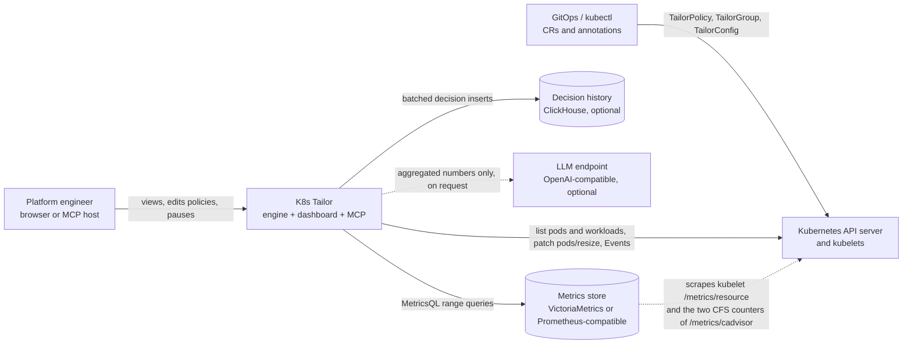

Notes:

- The metrics store scrapes two kubelet series (`container_cpu_usage_seconds_total`,
  `container_memory_working_set_bytes`) through the API server node proxy, plus (job `kubelet-cadvisor`) the two
  CFS counters `container_cpu_cfs_throttled_periods_total` and `container_cpu_cfs_periods_total` that feed the
  optional throttling signal. The engine itself never talks to a kubelet.
- ClickHouse and the LLM are optional. Without ClickHouse the engine keeps the last 200 decisions in memory.
- The LLM only ever receives aggregated figures and never decides or actuates ([section 11](#11-advisor-read-only)).

## 2. Containers

The processes that make up one release (C4 "container" level). All are installed by one Helm chart.

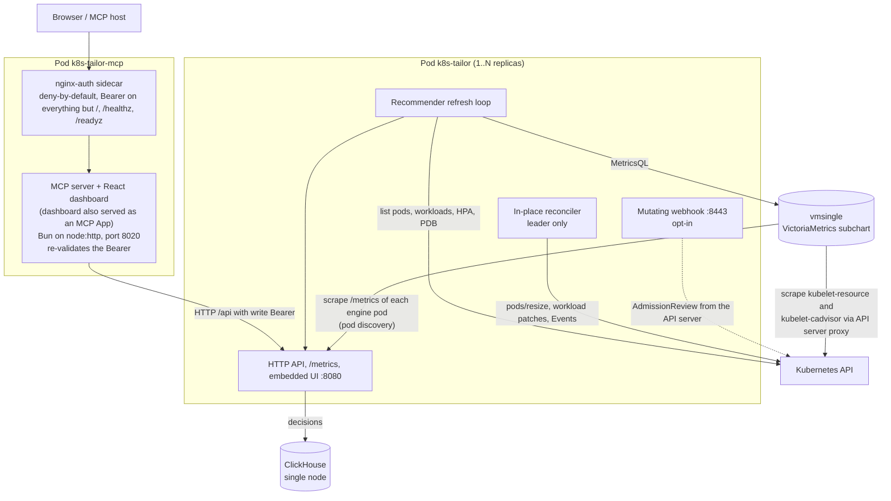

| Component | Role |
|---|---|
| Engine (Go, one static binary, `cmd/k8s-tailor`) | Refreshes recommendations every `REFRESH_EVERY` (default 60s), reconciles running pods every `RECONCILE_EVERY` (30s), reloads CRs every 30s, refreshes pricing every 5 minutes. Serves the API, `/metrics` and the embedded dashboard on `:8080`; serves the webhook on `:8443` (TLS) only when a certificate is mounted. |
| MCP server + dashboard (`mcp/`, Bun) | Exposes engine operations as MCP tools (`/mcp`, JSON-RPC over HTTP POST) and serves the same React dashboard. The dashboard is also published as an MCP App, the open MCP extension SEP-1865: a `ui://` resource served as `text/html;profile=mcp-app` (SDK `@modelcontextprotocol/ext-apps`, MIT), linked from each tool by `_meta.ui.resourceUri` (the legacy flat key is kept), so hosts that support MCP Apps render it inline and others get the text result. It runs on `node:http` (not `Bun.serve`) and routes on the **raw** request-target, answering 400 to any non-canonical path (`\`, `%`-escapes, `//`, `.`/`..` segments). It always requires `MCP_API_TOKEN` and refuses to start without one (only `MCP_ALLOW_UNAUTHENTICATED=true`, dev, opens it). Proxies the engine over HTTP (`TAILOR_API`); it does not talk to Kubernetes and has no ServiceAccount token. |
| nginx-auth sidecar | When `mcp.auth.enabled=true` (default) it listens on `:8080` and is **deny-by-default**: only `GET` of `/`, `/index.html`, `/healthz` and `/readyz` are open; every other path and method needs `Authorization: Bearer <token>` (exact-match `map`). The Bun server binds `127.0.0.1` and validates the same token again (defense in depth), so a path-confusion bug in one layer is not enough. The claim "cannot be bypassed" rests on this two-layer design plus the regression test `mcp/server/e2e/nginx-gate.sh` (CI job `mcp-gate`), not on the sidecar alone. |
| VictoriaMetrics (`victoria-metrics-single` subchart) | TSDB on a PVC, scrapes kubelet resource metrics every 5s (job `kubelet-resource`), the two CFS counters of cAdvisor every 15s (job `kubelet-cadvisor`) and the `/metrics` of every engine pod (job `tailor`, pod discovery). Retention 8d (default window is 7d). |
| ClickHouse (StatefulSet) | `decisions` table (MergeTree, TTL `CH_RETENTION_DAYS`, default 90). |

## 3. Deployment topology in the cluster

What lands where after `helm install -n k8s-tailor`. Names are fixed (one release per cluster), RBAC and
CRDs are cluster-scoped, everything else follows the release namespace. Dotted items are opt-in.

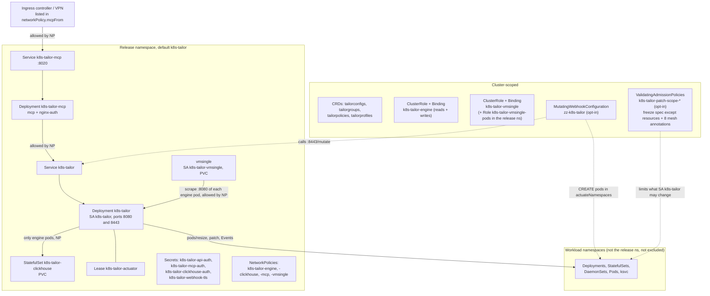

The NetworkPolicies are ingress-only (`networkPolicy.enabled`, default on, needs a CNI that enforces
them):

| Policy | Allows |
|---|---|
| `k8s-tailor-engine` | `:8080` from MCP pods, the bundled vmsingle and `networkPolicy.metricsFrom`; `:8443` from anywhere when the webhook is enabled (the API server is not selectable portably). |
| `k8s-tailor-clickhouse` | `:8123` and `:9000` from engine pods only. |
| `k8s-tailor-mcp` | The MCP port (8080 behind the sidecar, otherwise 8020) from pods of the release namespace plus `networkPolicy.mcpFrom`. |
| `k8s-tailor-vmsingle` | `:8428` (no authentication, accepts writes) from engine pods and `networkPolicy.metricsFrom` only. |

`networkPolicy.webhookFrom` optionally narrows `:8443` to the kube-apiserver's source addresses; empty means any source.
`kubectl port-forward` bypasses NetworkPolicy. They are rendered and checked structurally by `make chart-test`, and
`dev/calico/netpol-test.sh` checks on Calico v3.33.0 (one k3d node, Lima VM with kernel 6.8; 8 scenarios, 52 checks PASS, 0 FAIL in the recorded run, with a
negative control) that connections are blocked and allowed as in the table. Scope of that suite: one node, so `webhookFrom`
is not exercised against the API server (Calico does not filter ingress that originates on the node itself), and the CNI is
Calico ([dev/calico/README.md](../dev/calico/README.md), [E2E.md](E2E.md)). Without an enforcing CNI the policies do nothing.

The optional ValidatingAdmissionPolicies (`tailor.admissionPolicy.enabled`, Kubernetes >= 1.30) apply to UPDATEs made by the
engine ServiceAccount only. On Deployments, StatefulSets and DaemonSets the whole spec is frozen except each
container's and initContainer's `resources`; pod-template annotations may change only for `tailor.k8s-tailor.dev/*` and
the 8 exact mesh proxy-sizing keys (`sidecar.istio.io/proxy{CPU,Memory,CPULimit,MemoryLimit}`,
`config.linkerd.io/proxy-{cpu,memory}-{request,limit}`); labels, ownerReferences and finalizers are frozen. Pods are
frozen entirely (the `pods/resize` subresource is not matched). Knative Services are not covered.

RBAC summary (`chart/templates/rbac.yaml`): the engine ServiceAccount lists pods, workloads, ReplicaSets,
PDBs, HPAs; patches `pods`, `pods/resize` and `apps` workloads; creates Events; get/list/update Knative
`services`; manages the Tailor CRs; and has `get/create/update` on `leases` in the release namespace only.
A namespaced Role in the release namespace lets it create the warm-cache ConfigMap and get/update that one object (`tailor.warmCache`). No secrets, no `watch`, and no nodes or LimitRanges unless the opt-in `tailor.rbac.clusterLookups` adds `list` on `nodes` and `limitranges`. vmsingle has its own ServiceAccount with `nodes` get/list/watch and
`nodes/proxy` get; a namespaced Role gives it `pods` get/list/watch in the release namespace for the per-pod scrape of the engine.

## 4. Data flow: metrics to actuation

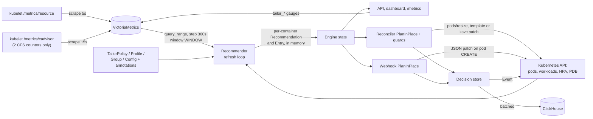

Usage series are attributed to a workload through the pods that exist and, for pods that were replaced, through their generated names
(`ClusterSnapshot.OwnerOf`: `<ReplicaSet>-<suffix>` of a Deployment's ReplicaSet, `<DaemonSet>-<suffix>`), so a rollout does not discard the history
([TECHNICAL.md](TECHNICAL.md#1-metrics-sources-and-queries)).

The recommender is read-only: it fills an in-memory set of recommendations. Actuation is a second
stage that consumes it. `reconciler.PlanInPlace` is shared by the reconciler and the webhook, so live resize
and admission-time sizing cannot disagree (`internal/reconciler/decide.go`). The same decision code
is replayed offline by `k8s-tailor backtest` ([BACKTEST.md](BACKTEST.md)).

## 5. In-place reconcile sequence

One reconcile tick for one container of a running pod (`internal/reconciler/reconciler.go:reconcileNS`).
Only the leader runs this loop.

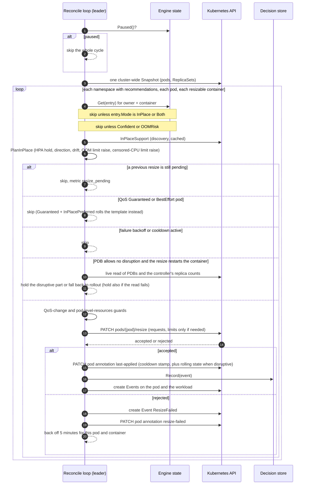

Details worth knowing:

- The cooldown key is per workload and container. After the first replica is resized, its siblings follow
  in the same cycle (non-disruptive resizes only), so N replicas converge in one cycle rather than N cooldowns.
- A resize that restarts the container (`resizePolicy: RestartContainer` for the resource that moves) is
  *disruptive*: at most one pod per cycle (or the PDB's `disruptionsAllowed`), and only while every other
  replica is Ready. The PDB budget and the replica counts are read live from the API server right before the
  restart (not from the last refresh); the failure backoff and the rolling state are stored as pod annotations
  (`tailor.k8s-tailor.dev/resize-failed`, `/rolling`), so a restart or failover keeps them.
- The pod annotation write is a separate patch because the `pods/resize` subresource only accepts resources.

## 6. Admission webhook sequence

Opt-in (`tailor.webhook.enabled=true` plus `tailor.actuateNamespaces`). It sizes pods at creation, which is
the only path for ephemeral pods that a controller mints on demand. `failurePolicy: Ignore` and a 5 second
timeout mean pod creation never blocks on it.

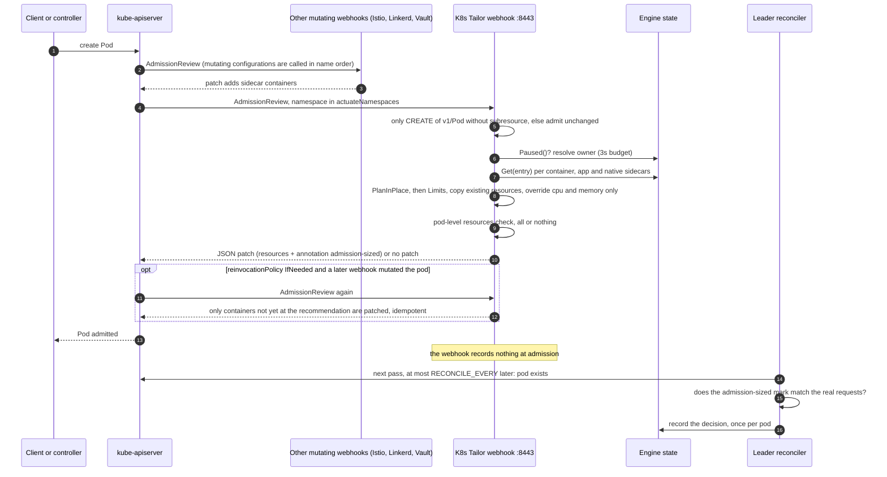

The webhook never writes the decision log: the pod does not exist yet and `:8443` has no caller authentication, so a forged AdmissionReview must not be able to
fabricate history. Only a `CREATE` of `v1/Pod` without subresource is patched. The patch carries the pod annotation `tailor.k8s-tailor.dev/admission-sized`
(container to from/to), and the leader's reconciler records the decision when it sees the pod, once, and only if the mark agrees with the requests the pod has.
Nothing is recorded while the engine is paused or has no leader; `dryRun` admissions get the patch but are never recorded. The decision therefore shows up in the
log and in `tailor_mutations_total` with a delay of up to `RECONCILE_EVERY`.

The configuration is named `zz-k8s-tailor` so that it sorts late, but the name is not what makes it correct: Kubernetes only promises
an unspecified order, and with real Istio 1.31.3 (whose injector has `reinvocationPolicy: Never`) the API server called this webhook
**twice per pod** whether it was named `aa-` (before the injector) or `zz-` (after it), and the patch stayed idempotent
([dev/istio/README.md](../dev/istio/README.md), scenario 5, classic and native sidecars). `reinvocationPolicy: IfNeeded` is the actual guarantee.
Until the first refresh has finished, or for a container whose recommendation is not confident, the webhook admits the pod unmodified and counts
`tailor_webhook_skipped_total{reason}` (`warming_up`, `not_confident`). A pod whose template is QoS Guaranteed is also admitted
unmodified (`guaranteed_qos`), so it is not born Burstable, unless the policy says `guaranteed: resizeBoth` (request and limit are then set together). Container classes and mesh handling: [CONTAINERS.md](CONTAINERS.md).

## 7. Resize state machine

Kubernetes (>= 1.33) reports an outstanding resize as Pod conditions. The engine reads them in
`internal/k8s/client.go:resizeState` and exposes the count per state as
`tailor_pods_resize_state{state=...}`. While a pod has any state, the reconciler does **not** stack
another patch on it.

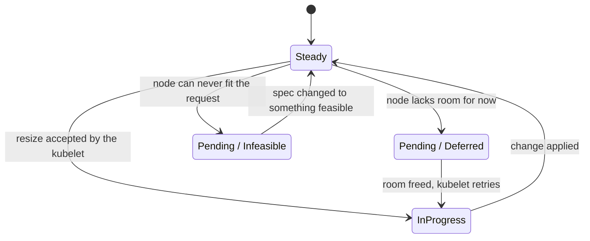

- `Pending/Deferred`: not possible now, may be later; the kubelet retries.
- `Pending/Infeasible`: impossible on this node (for example more CPU than the node has). The engine emits a
  `ResizeInfeasible` Warning Event (deduplicated, 1 per hour) because only this state needs a human.
- `InProgress`: accepted, being applied. Actuation errors show up in the condition message.
- On clusters up to 1.32 the engine falls back to the deprecated `status.resize` field.

Reference: Kubernetes docs, "Resize CPU and Memory Resources assigned to Containers".

## 8. Decision flowchart

Which gates run, in order, before a number becomes a patch. Precedence for the *mode* is
annotation > policy > config; sidecars have an extra cap ([section 9](#9-container-classification-and-sidecars)).

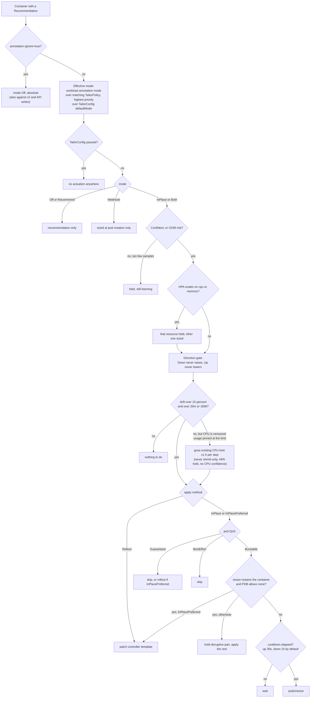

HPA hold means: if an HPA targets CPU (or memory) utilization, that resource's request is the denominator of the
HPA's math, so the engine recommends but never moves it. Knative's KPA scales on concurrency and does not trigger a
hold. The OOM floor and the memory-limit rules are in [TECHNICAL.md](TECHNICAL.md#5-oom-learned-floor-and-limit-rules).

## 9. Container classification and sidecars

Every pod is read container by container. The class decides the default policy and which actuation paths are legal.
Names are matched against a built-in glob list (`istio-proxy`, `linkerd-proxy`, `envoy`, `vault-agent*`,
`cloud-sql-proxy`, `queue-proxy`, ...) extended by `TailorConfig.spec.sidecarNames`
(`internal/k8s/containers.go`).

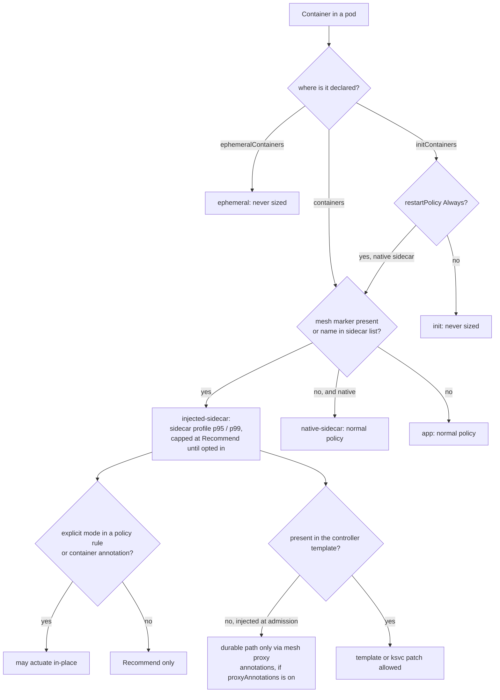

A container the running pods carry but the template does not (a sidecar added by a webhook) is always classified
`injected-sidecar` and is never patched into the template (a strategic merge on a missing name would append a bogus
container). Mesh markers: `sidecar.istio.io/status` for Istio, `linkerd.io/proxy-version` or the
`linkerd.io/control-plane-ns` label for Linkerd. Per-container policy: `spec.containers` rules on a TailorPolicy or
TailorProfile, or annotations `tailor.k8s-tailor.dev/container.<name>.{mode,exclude,profile,apply,direction,min-cpu,max-cpu,min-mem,max-mem,proxy-annotations}`.
Full behavior: [CONTAINERS.md](CONTAINERS.md).

## 10. Leader election

Every replica recommends and serves the API, the dashboard and the webhook. Only the holder of the
`coordination.k8s.io` Lease runs the reconciler, so `tailor.replicas > 1` never double-resizes
(`internal/leader/leader.go`, defaults 15s lease, 10s renew deadline, 2s retry).

Shutdown (commit `2362fe2`) is ordered on SIGTERM, in this sequence: (1) the leader stops actuating and waits for the running pass to return (up to 10 s), (2) **then** releases the Lease, so a standby takes over without waiting for expiry and never overlaps with the old leader, (3) the API and webhook servers drain (`Shutdown`, not `Close`), (4) the ClickHouse buffer is flushed (`Store.Flush`), (5) exit. The chart sets `tailor.terminationGracePeriodSeconds: 30`.

`ReleaseOnCancel` was already enabled; it was not the problem. The roughly 40 s without a leader seen on a rolling update in the k3d failover ([E2E.md](E2E.md), scenario 7, which ran before the fix) came from the order: `main` exited as soon as the HTTP server closed, without waiting for the elector to release the Lease, and client-go released it concurrently with a pass still running (a brief window with two actuators), so the next pod waited for the Lease to expire. The ordering is covered by unit tests in `internal/leader`.

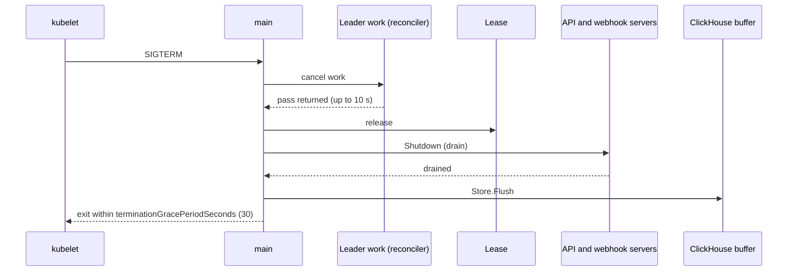

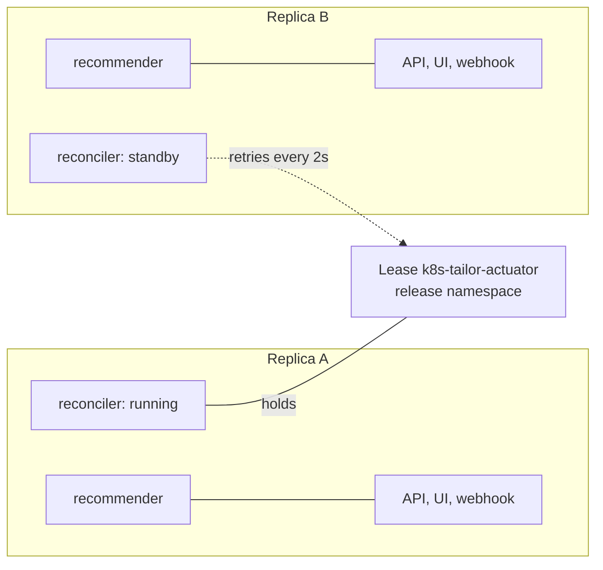

On shutdown the Lease is released, so a standby takes over in about one retry period instead of a full lease
duration. The cooldown, the failure backoff and an in-progress disruptive rolling are rebuilt after failover from pod
annotations (`last-applied`, `resize-failed`, `rolling`); the scale-down stabilizer is re-seeded by replaying the
recommendation at past steps. The in-memory decision ring buffer (without ClickHouse) is per replica
([KNOWN-ISSUES.md](KNOWN-ISSUES.md)).
`tailor_leader` is 1 on the acting replica. The chart refuses `tailor.replicas > 1` with
`tailor.leaderElection.enabled=false`.

## 11. Advisor (read-only)

An optional second opinion from an OpenAI-compatible endpoint. Off by default. The `internal/advisor` package does not
import the reconciler, webhook, k8s client or recommender (a test enforces it), so it cannot actuate.

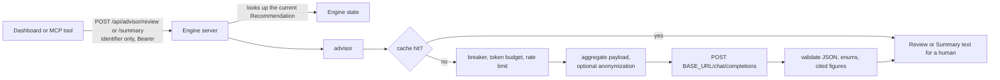

The client sends only an identifier; the numbers come from the engine's own recommendation, so the endpoint cannot be
used as a free LLM proxy. Details, guard-rails and provider recipes: [ADVISOR.md](ADVISOR.md).

## 12. CRD data model

All four CRDs are cluster-scoped, group `tailor.k8s-tailor.dev`, version `v1alpha1`. They are chart templates (not
`chart/crds/`) so upgrades apply schema changes, and they carry `helm.sh/resource-policy: keep`.

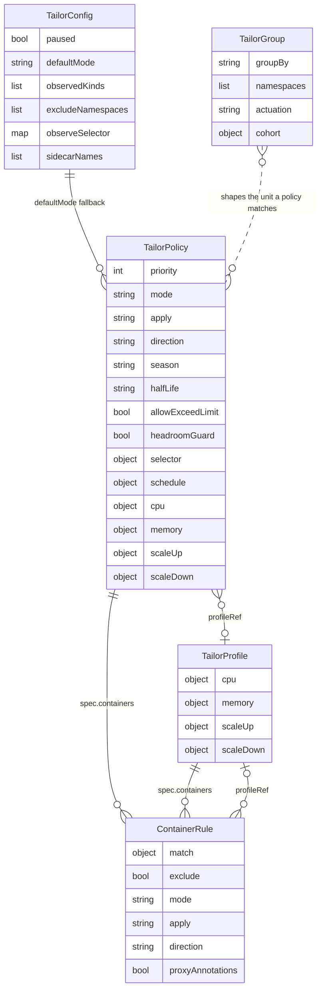

| Kind (short name) | Role |
|---|---|
| `TailorConfig` (`rscfg`) | Singleton named `cluster`: global pause, default mode, observed kinds, excluded namespaces, label selector, extra sidecar-name globs. Seeded by the engine on first start. |
| `TailorPolicy` (`rsp`) | Selector (namespace globs plus `matchLabels`) plus `priority`; sets mode, method, direction, quantiles, margins, min/max, limit factors, cooldowns, season, schedule windows and per-container rules. The highest-priority match wins; there is no merging between policies. |
| `TailorProfile` (`rsprof`) | Reusable sizing recipe (cpu/memory/cooldowns/container rules) referenced by `profileRef` or the `tailor.k8s-tailor.dev/profile` annotation. |
| `TailorGroup` (`tgrp`) | Collapses workloads that share a label (or a whole namespace) into one logical unit with pooled usage. Carries no mode. |

"Group" means two unrelated things: a **TailorPolicy** is the *automation* group (a selector turns actuation on for
everything it matches, including future workloads); a **TailorGroup** is the *collapse* group (many workloads become one
row). Default with no TailorGroup: Knative revisions collapse by `serving.knative.dev/service` with `ksvc` actuation.
Annotations (`tailor.k8s-tailor.dev/`): `mode`, `ignore`, `profile`, `container.<name>.*` (set by you),
`last-applied` and `oom-floor` (written by the engine).

## 13. Go module map

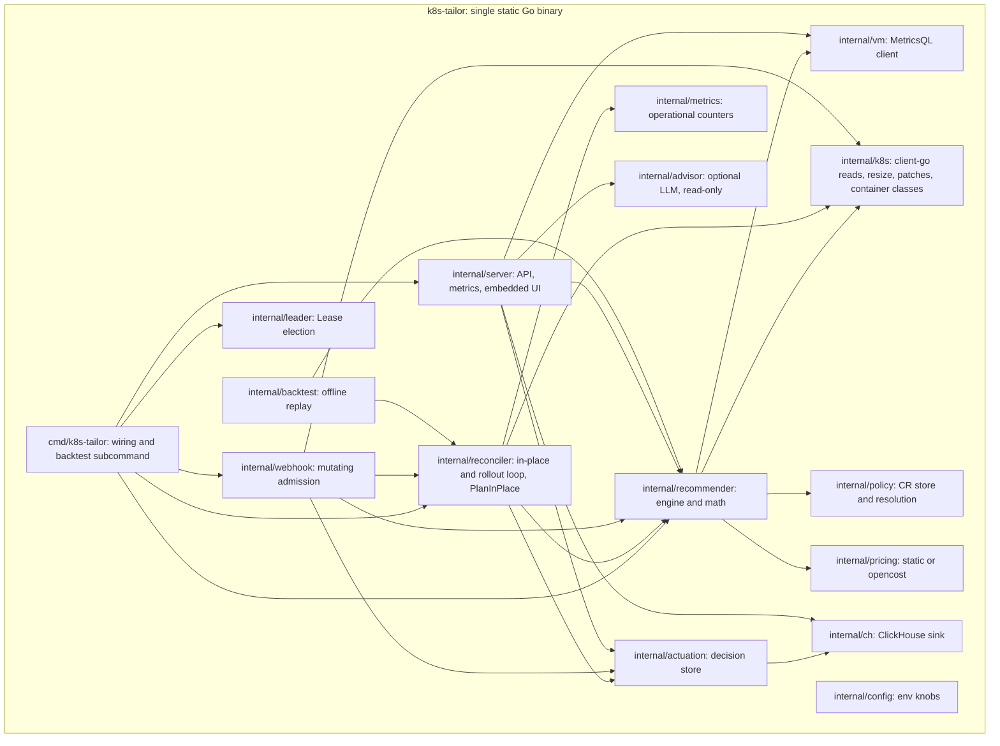

The MCP server and dashboard live in [`../mcp`](../mcp) (Bun runtime with `node:http`, React) and ship as their own image from
the same chart. The standalone dashboard bundle is built by `make ui-build` into `web/dist/index.html` and embedded
in the engine with `go:embed`.
