# Screens

A tour of the dashboard: what each screen shows, how to read it, which actions it offers and where it lives in the code.

> **Except for the last section ("Screens from a real cluster"), all screenshots use the dashboard's built-in synthetic fixture data** (invented workloads such as `portal/gateway`, `serving/api`, `ingress/ingress-nginx`; the header counts 21 entries, one per container),
> served by the dev fixtures transport (`mcp/web/dev-fixtures/fixtures.ts`, enabled with `?fixtures` in dev). They are **not** from a real cluster, the numbers and dollar amounts are made up, and the AI advisor text is a canned fixture response
> (no LLM was called).

The same React bundle is served two ways: by the MCP server (`mcp/`, port 8020, behind the deny-by-default, Bearer-gated nginx sidecar; the token is also checked by the server itself) and embedded in the engine (`web/dist/index.html`, port 8080). Screens are hash routes (`#/overview`,
`#/workloads`, `#/savings`, `#/policies`, `#/grouping`, `#/decisions`, `#/health`), so they can be linked and survive a reload. Design notes: [DESIGN.md](DESIGN.md). Reproduce the shots locally:

```bash
cd mcp && bun install && bun run dev:web          # Vite on http://localhost:5179
# open http://localhost:5179/web/entries/dashboard-ui.html?fixtures#/overview
# variants: ?fixtures=empty | error | auth | advisor-off | advisor-429 | advisor-503 | advisor-502 | advisor-401
```

The header is common to every screen: the actuation badge (`Actuating`, `Dry-run`, `Paused`), the `Cost: estimate` badge (prices are static unless OpenCost is wired), the global **Pause actuation** switch
(`TailorConfig.spec.paused`, stops the reconciler and the webhook), a keyboard-shortcuts help and a refresh button.

## Overview

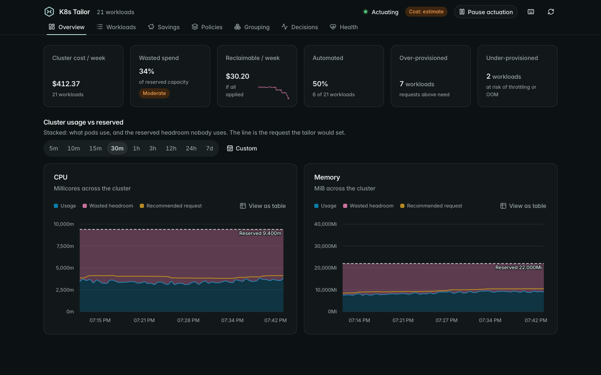

Six KPIs (cluster cost per week, wasted spend as a share of reserved capacity with a High/Moderate/Low badge, reclaimable dollars per week with a sparkline, percent of workloads automated, count of over-provisioned and
under-provisioned workloads) over two stacked charts, CPU and memory: blue is measured usage, pink is the reserved headroom nobody uses, the yellow line is the request the tailor would set, and the dashed line is the total reserved.
How to read: a tall pink band means reclaimable capacity; usage touching the yellow line means little headroom. Actions: change the range (5m to 7d or custom), view as table, pause actuation. Code: `mcp/web/views/overview.tsx`,
data from `GET /api/overview`.

## Workloads

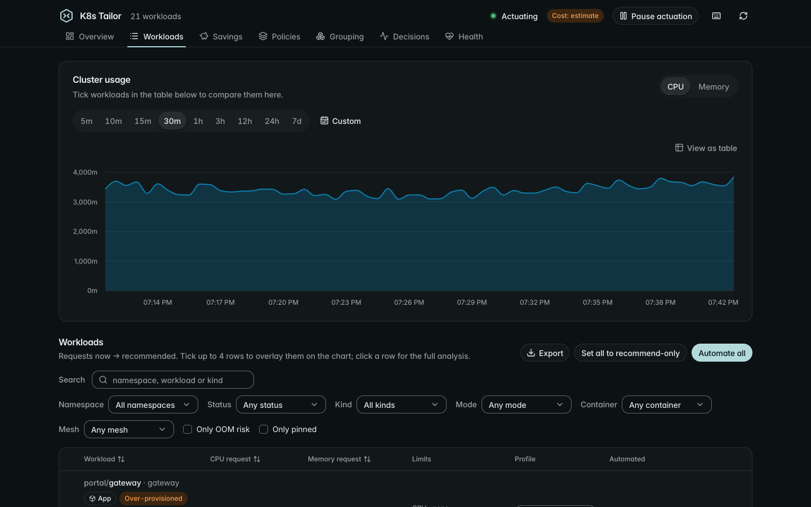

One row per container, grouped under its workload. Each row shows a class badge (`App`, `Native sidecar`, `Sidecar · istio`, `Init`), status badges (Over-provisioned, Right-sized, HPA cpu, Applied 1m ago), kind, the
current-to-recommended request for CPU and memory, the limits, the profile selector, the effective mode with its origin (`from policy`, `rule 2 of policy apps`) and the estimated dollars per week. The `istio-proxy` row shows
"Recommend-only until opted in": sidecars are never actuated until a rule or annotation says so. The `istio-init` row reads "Not sized": init containers cannot be resized. A resource whose recommendation is still being held shows an hourglass hint under the row (`CPU held: not enough samples yet`, `Memory held: ...`), see the second shot below. Actions: search and filter (namespace, status, kind, mode, container class, mesh,
only OOM risk, only pinned), sort, tick up to 4 rows to overlay on the usage chart, export the filtered rows (CSV/JSON), bulk "Automate all" and "Set all to recommend-only", per-workload Automated toggle and profile; the mode select of an injected-sidecar row; a row opens the sheet. Code:
`mcp/web/views/workloads.tsx`, `mcp/web/lib/workload-filter.ts`. Writes use `POST /api/workload`.

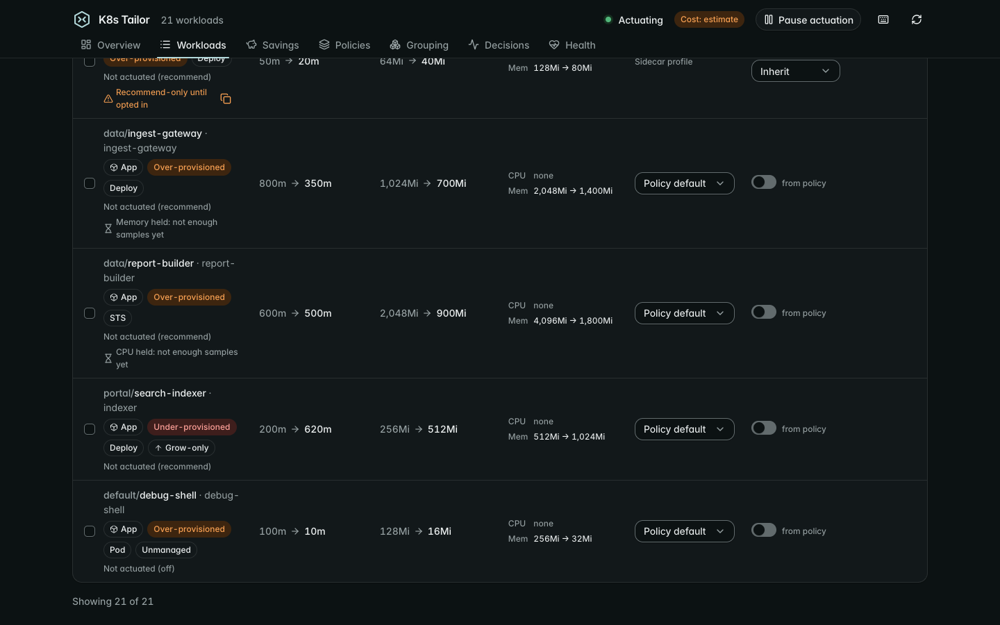

The end of the same table: `pay/payments · audit-agent` is a recommend-only sidecar, `data/ingest-gateway` holds its memory and `data/report-builder` holds its CPU ("not enough samples yet") because too little history exists to size that resource safely; the other resource of the same container is still recommended.

## Workload sheet

Opens on the right when a row is clicked.

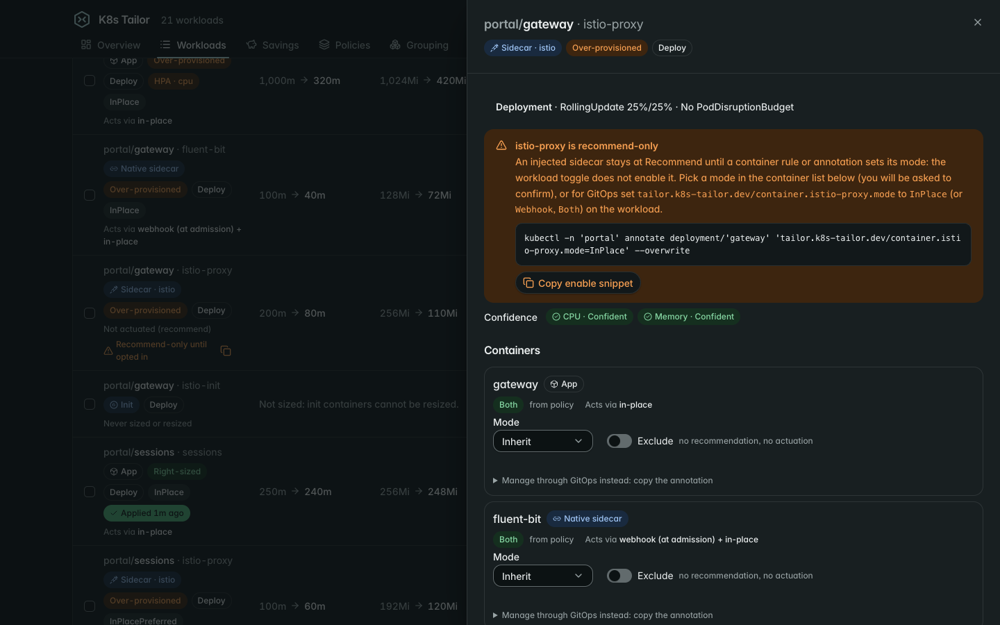

Context first (here: Deployment, rolling update 25%/25%, no PodDisruptionBudget, and a warning that an HPA scales on CPU so the CPU request is held and only memory is managed), then the list of every container of the pod with its class,
effective mode, origin and actuation path (`in-place`, `webhook (at admission) + in-place`, "Not in template"). Each container row has a **Mode** select (Inherit, Off, Recommend, Webhook, InPlace, Both) and an **Exclude** switch, written through `POST /api/workload` with `container`
(optimistic update with rollback, engine errors shown as sentences). Choosing an actuating mode on an injected sidecar asks for confirmation, because an explicit mode is the opt-in. The controls are disabled for init and ephemeral containers (never resized) and for Knative-service and group
workloads (per-container writes are not supported there). The copy buttons with the equivalent annotation stay available for GitOps. The sheet also shows **per-resource confidence** badges (`CPU · Confident`, `Memory · Gathering data`, or `Not reported` for an older engine) and says which resource is held.
An `ignore` annotation still wins over any of these writes. Code: `mcp/web/views/workload-sheet.tsx`, `mcp/web/components/container-info.tsx`, `mcp/web/components/container-controls.tsx`, `mcp/web/components/confidence-badges.tsx`.

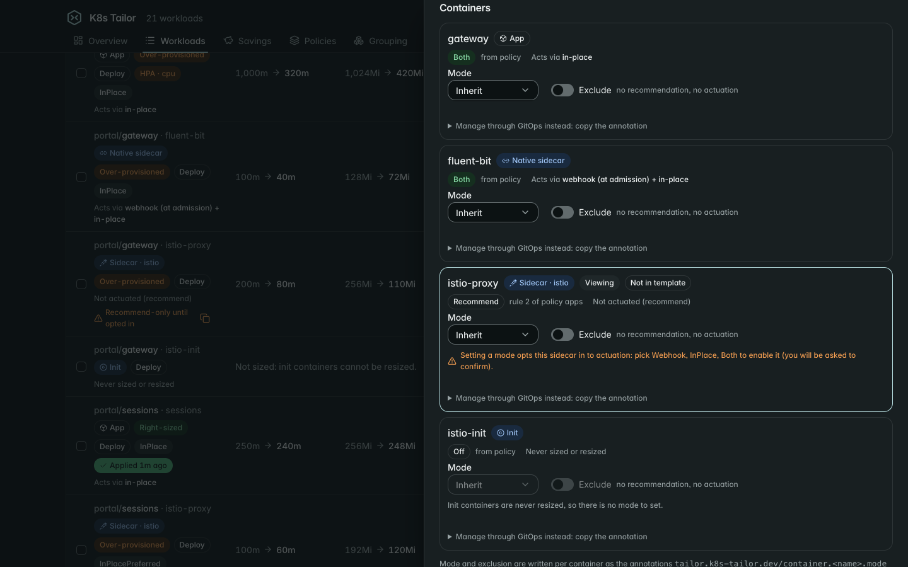

The container list scrolled into view: `gateway` (app) and `fluent-bit` (native sidecar) inherit their mode, `istio-proxy` (injected sidecar, "Not in template", Recommend from rule 2 of policy `apps`) shows the opt-in warning under its select, and `istio-init` has its controls disabled with the reason.

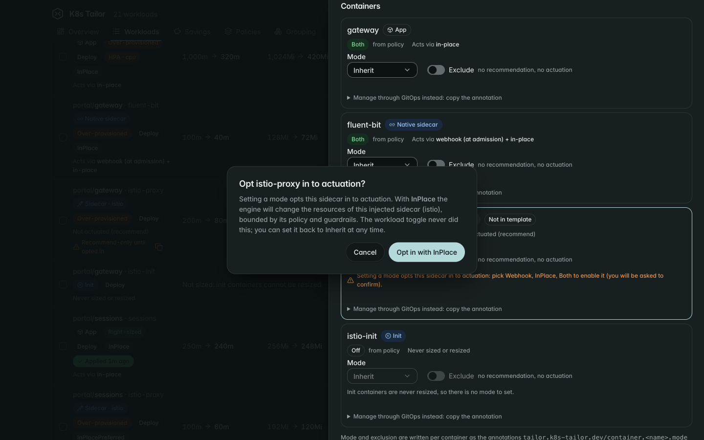

Picking an actuating mode (here InPlace) on `istio-proxy` opens this confirmation first: the explicit mode is the opt-in, it is bounded by the policy and guardrails, and it can be set back to Inherit at any time. Cancel leaves the sidecar at Recommend and writes nothing.

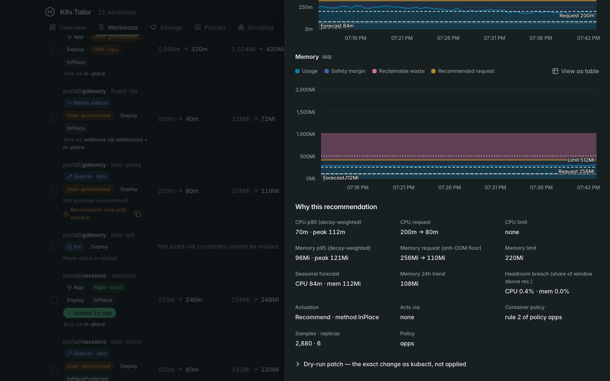

The charts (CPU and memory: usage, safety margin, reclaimable waste, recommended request, current request and limit) and the **Why this recommendation** grid: decay-weighted p90 and the peak for CPU, p95 and the peak for memory, the
seasonal forecast, the 24 h memory trend, the headroom breach (share of the window above the recommendation), the CPU burstiness index (p99 / p90) with the quantile the request was sized from and the reason, the CPU demand state when the usage is pinned at the CPU limit (including the CPU-greedy badge), the actuation method, and the sample and replica counts. This is the audit view: every number of the recommendation can be traced here
([TECHNICAL.md](TECHNICAL.md#2-recommendation-model)).

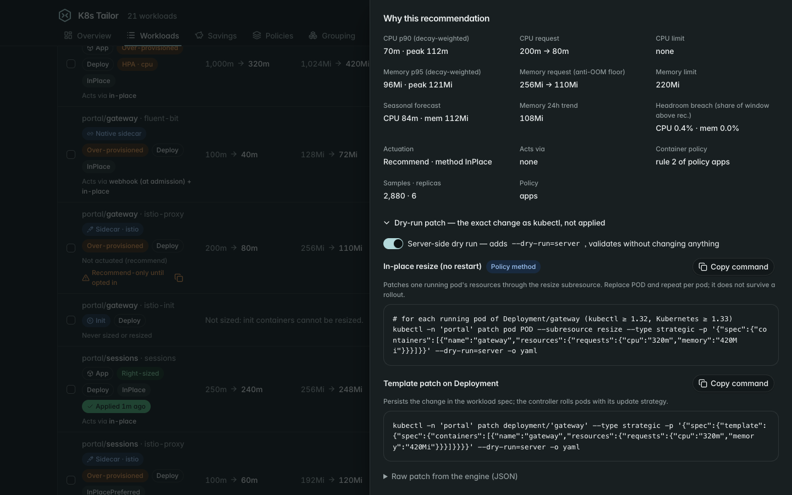

**Dry-run patch**: the exact change as `kubectl`, not applied: the per-pod `--subresource resize` patch (kubectl >= 1.32, Kubernetes >= 1.33) and the controller template patch, with a toggle that adds `--dry-run=server`, and the raw engine JSON.
It reads `GET /api/patch/{ns}/{kind}/{workload}/{container}`, which never mutates anything.

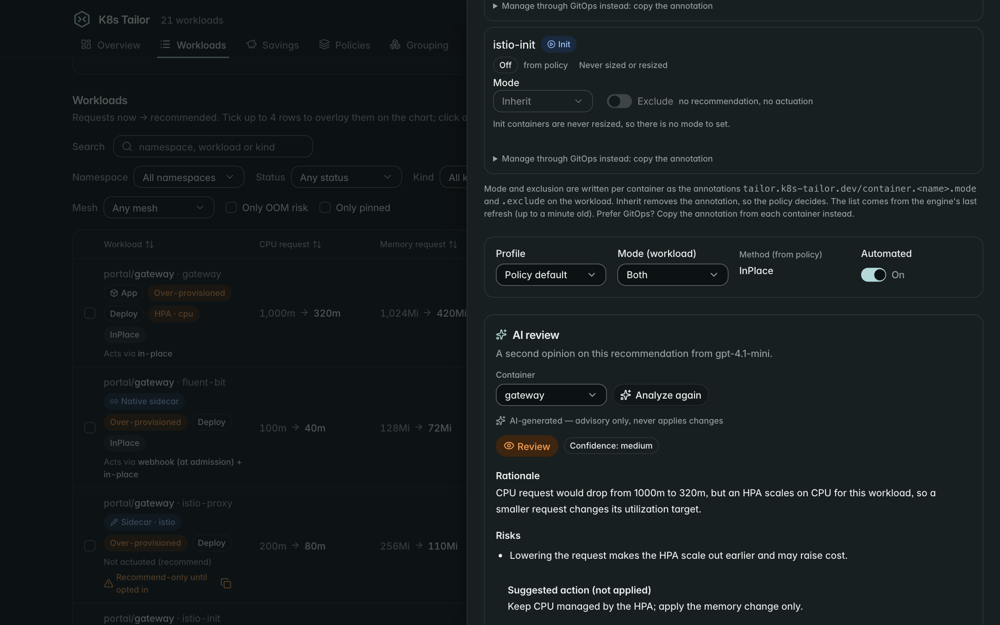

Optional **AI review** (only when the advisor is enabled): a second opinion with a verdict (`ok`, `review`, `risky`), a confidence, rationale, risks, a suggested action that is explicitly "not applied", and a table of the numbers the model
cited, which the engine validated against the payload it sent. Advisory only; it never applies anything ([ADVISOR.md](ADVISOR.md)). Code: `mcp/web/components/advisor.tsx`, `POST /api/advisor/review`.

## Policies

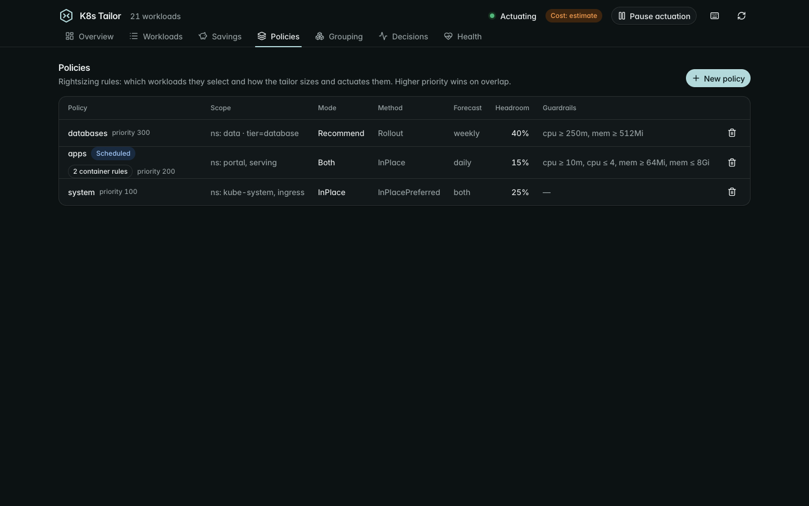

The automation groups: each `TailorPolicy` with its scope (namespaces and labels), mode, method, forecast season, headroom and guardrails (min/max). Higher priority wins on overlap. The "Scheduled" badge marks a policy with schedule windows and
"2 container rules" marks per-container rules. Actions: new policy, edit, delete (with a confirm dialog). Code: `mcp/web/views/policies.tsx`; writes through `POST /api/policies` (merge semantics: only the fields you send change) and `DELETE /api/policies/{name}`.

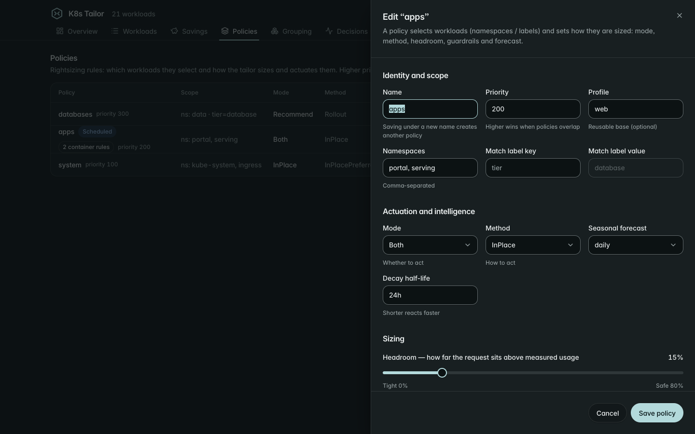

The editor sheet: identity and scope (name, priority, profile, namespaces, a match label), actuation (mode, method, seasonal forecast, decay half-life), sizing (a headroom slider with a usage-versus-headroom preview), guardrails and schedule below.

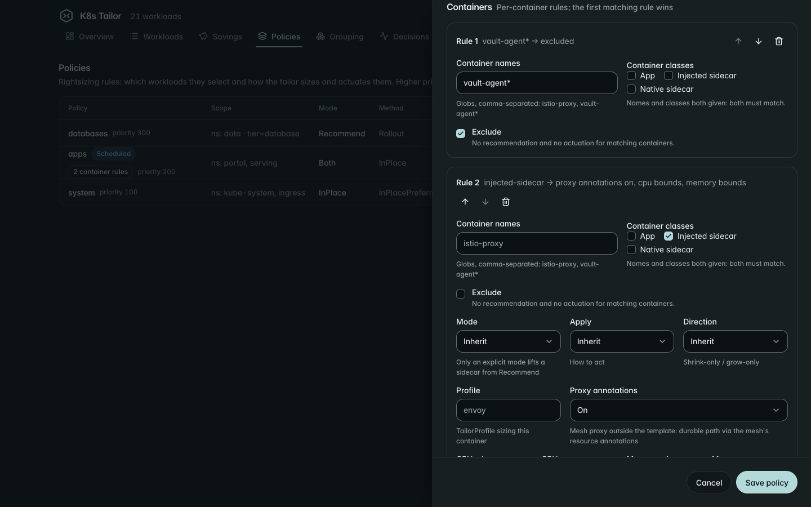

**Container rules**: ordered, first match wins. Rule 1 excludes `vault-agent*` from any recommendation or actuation; rule 2 targets the `injected-sidecar` class, turns proxy-annotations on (the durable path for a mesh sidecar that is not in the template),
references a TailorProfile and sets bounds. A rule's mode, if set, is the only thing that lifts a sidecar from `Recommend`. Code: `mcp/web/views/policy-containers.tsx`, `mcp/web/lib/policy-rules.ts`.

## Grouping

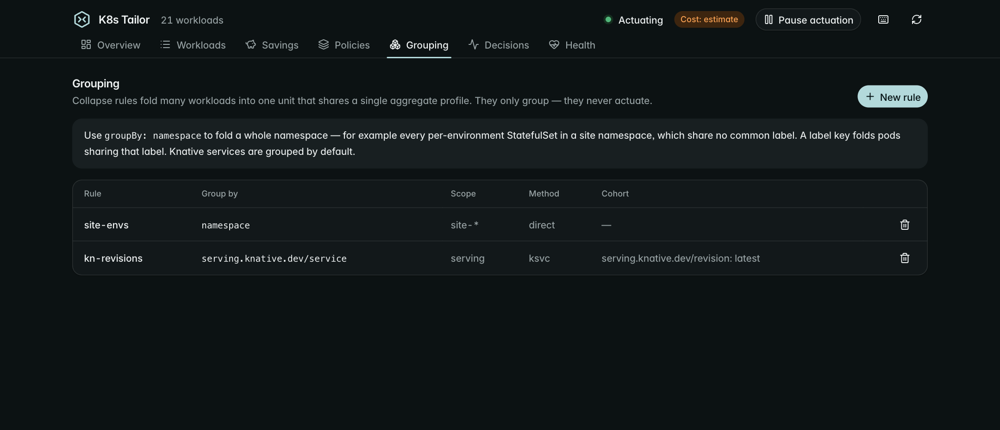

Collapse rules (`TailorGroup`): many workloads folded into one unit with pooled usage. `site-envs` folds every namespace matching `site-*` (`groupBy: namespace`, direct); `kn-revisions` folds Knative revisions by `serving.knative.dev/service`
with `ksvc` actuation and the `latest` cohort. Groups only collapse; they never turn actuation on (that is a policy). Code: `mcp/web/views/grouping.tsx`; `POST /api/groups`, `GET /api/groups/{name}/members`.

## Decisions

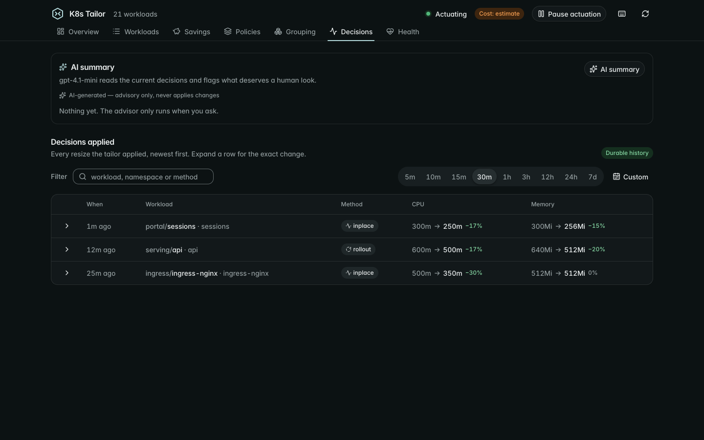

Every applied resize, newest first: when, workload and container, method (`inplace`, `rollout`, ...), CPU and memory before and after with the percent change. "Durable history" means the data comes from ClickHouse and survives restarts; without
it the badge is absent and the list is the engine's 200-event ring. The AI summary box above is the optional advisor. Rows expand to the exact change. Code: `mcp/web/views/decisions.tsx`; `GET /api/actuations`.

## Savings

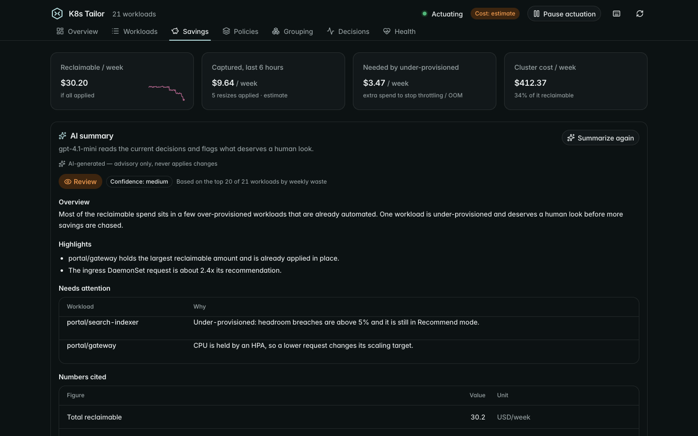

Reclaimable per week, captured in the last 6 hours (an estimate from applied decisions), spend needed by under-provisioned workloads, and cluster cost; a six-hour timeline; a top list of reclaimable workloads; and the optional **AI summary**
(overview, highlights, a "needs attention" table, and the figures it cited). All dollar values are estimates from static prices unless OpenCost is configured. Code: `mcp/web/views/savings.tsx`, `mcp/web/lib/savings.ts`; `GET /api/economy`.

## Health

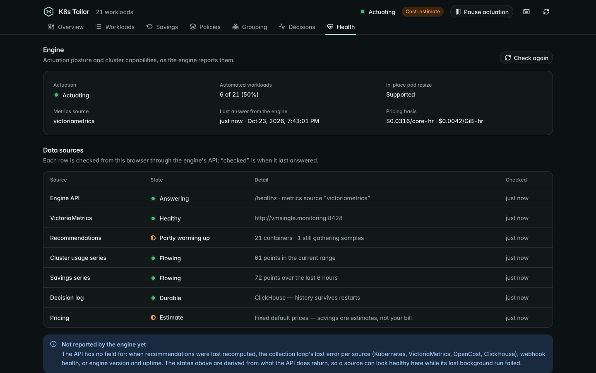

Actuation posture, number of automated workloads, whether in-place pod resize is supported by the cluster, the metrics source and pricing basis, plus a table of data sources checked from the browser (engine API, VictoriaMetrics, recommendations
warming up, usage and savings series, the decision log, pricing). The blue note at the bottom lists what the API does not report yet (last recompute time, per-source errors, webhook health, engine version). The "monitoring" host in the VictoriaMetrics row is
a fixture value. Code: `mcp/web/views/health.tsx`.

## Token dialog

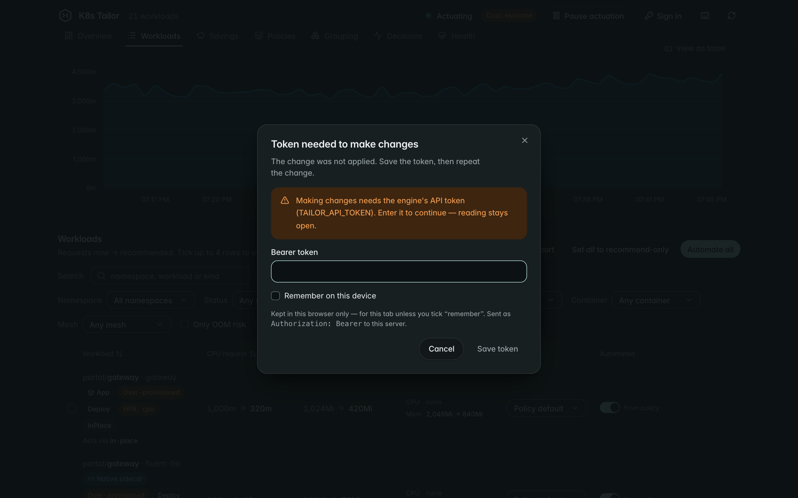

On the engine's own UI (port 8080) a change needs the write token when the engine has one. A failed change shows the banner and opens this dialog; save the token (kept in the tab's session storage unless "Remember on this device" is ticked) and repeat the
change. Through the MCP, the server forwards the engine token itself and the UI only needs the MCP token (a full-screen sign-in). Code: `mcp/web/components/auth.tsx`, `mcp/web/lib/auth.ts`. This shot uses `?fixtures=auth`.

## Mobile

<p>
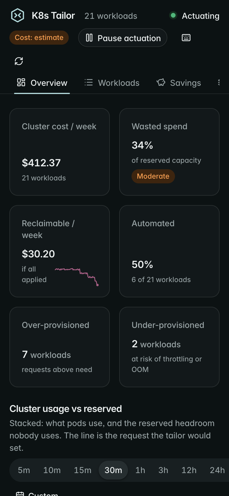
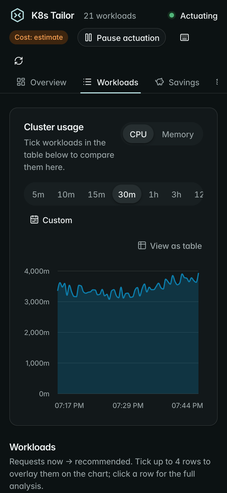
</p>

The layout is responsive (390 px wide here): the header wraps, the tabs scroll horizontally, KPIs and charts stack, and the filters become a labeled list above the table.

## Screens from a real cluster

These three come from the end-to-end run documented in [E2E.md](E2E.md): a single-node k3d cluster (k3s v1.34) with demonstration load (`e2e-*` workloads, burner pods, a fake Istio-style proxy), engine and MCP built from this repository. The numbers are
real outputs of that run but come from small synthetic workloads, not from production, so read them as proof that the screens work against a live engine and not as savings evidence. The cost figures are estimates from static prices.

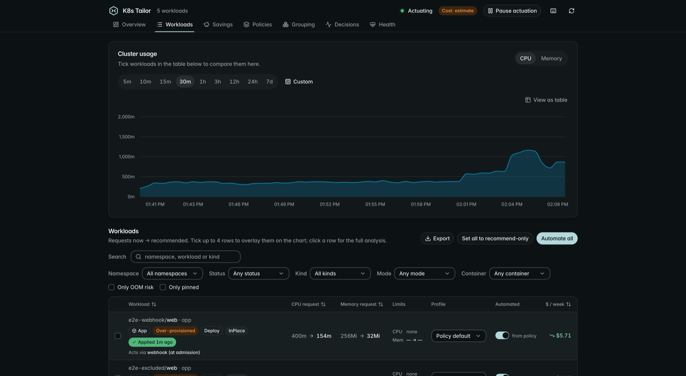

Workloads after the run: `e2e-webhook/web` went from 400m / 256Mi to 154m / 32Mi at admission ("Acts via webhook (at admission)", "Applied 1m ago"), with the cluster usage chart above the table.

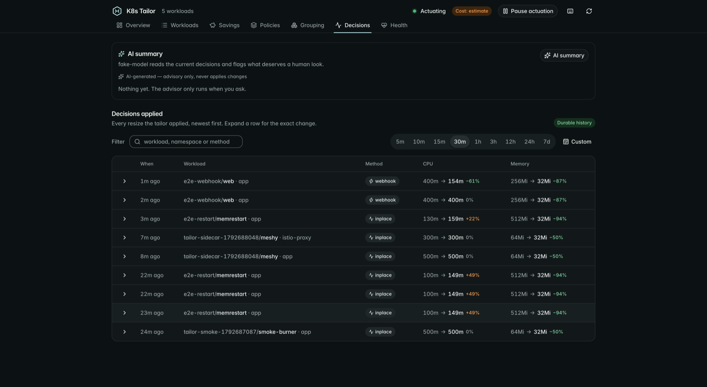

The decision log with the durable (ClickHouse) history: `webhook` and `inplace` decisions with the exact CPU and memory change, including the `istio-proxy` imitation container and the disruptive-restart scenario.

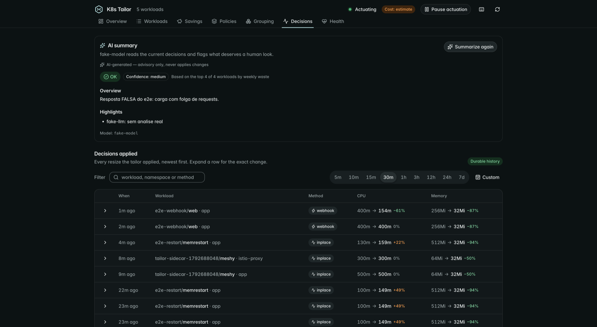

The advisor summary on the same Decisions view. **The model here is a deliberately fake OpenAI-compatible server** (`fake-model`, canned placeholder text): the shot proves the plumbing (UI, MCP, engine, advisor route, token forwarding), not any analysis quality.
